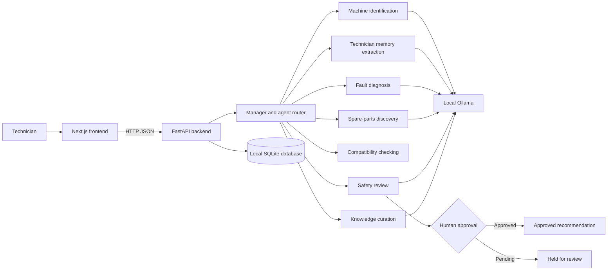
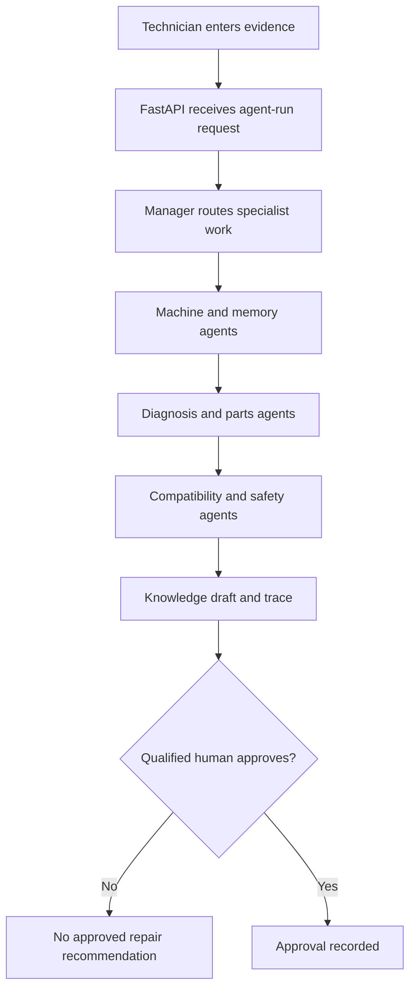

# MachineMemory AI

MachineMemory AI is a local-first industrial maintenance knowledge system with a Next.js interface, FastAPI backend, and Ollama inference.

Everything runs directly on the same Windows or development machine. The project does not require Docker, containers, cloud model APIs, API keys, or an external database.

## Architecture





## Features

- Manager/orchestrator agent
- Machine identification agent
- Technician-memory extraction agent
- Fault diagnosis agent
- Spare-parts discovery agent
- Compatibility checking agent
- Safety review agent
- Knowledge curation agent
- Agent trace and status display
- Machine, repair-memory, and spare-parts panels
- Text entry and text-file upload
- Explicit human approval gate
- Local SQLite persistence
- Ollama-only inference

## Technology

| Layer | Technology |
|---|---|
| Frontend | Next.js, React, TypeScript, Tailwind CSS |
| Backend | Python, FastAPI, Pydantic |
| Agents | Python router and specialist classes |
| LLM | Local Ollama |
| Database | Local SQLite |

No Docker, container runtime, cloud LLM, API key, or external database is required.

## Project layout

```text
src/app/page.tsx          Next.js maintenance workspace
backend/app/main.py       FastAPI API and startup
backend/app/orchestrator.py
                          Agent manager/router
backend/app/agents.py     Specialist agents
backend/app/ollama.py     Local Ollama HTTP client
backend/app/db.py         SQLite connection and schema
backend/app/schemas.py    Typed API models
backend/tests/            Health and router tests
.env.example              Local environment template
```

## Database storage

The native SQLite database is stored at:

```text
backend/machinememory.db
```

It is created automatically when FastAPI starts. Tables are:

- `machines`
- `memories`
- `parts`

No database server or account is needed.

Back up the data by copying `backend/machinememory.db` while the backend is stopped.

To reset the database:

```powershell
Remove-Item .\backend\machinememory.db
```

Restart FastAPI afterward; it recreates the database and tables.

## Prerequisites

- Windows 10 or 11
- Python 3.11 or newer
- Node.js 20 or newer
- Ollama for Windows

No cloud account or model API key is required.

## Ollama setup

Start Ollama:

```powershell
ollama serve
```

Install a model:

```powershell
ollama pull qwen2.5:1.5b
```

Verify it:

```powershell
ollama list
```

The project default is `llama3.2`. The currently recommended small Windows test model is `qwen2.5:1.5b`.

Set the model in PowerShell:

```powershell
$env:OLLAMA_MODEL = "qwen2.5:1.5b"
```

Or copy `.env.example` and edit it:

```powershell
Copy-Item .env.example .env
```

## Configuration

| Variable | Default | Purpose |
|---|---|---|
| `OLLAMA_BASE_URL` | `http://localhost:11434` | Local Ollama server |
| `OLLAMA_MODEL` | `llama3.2` | Ollama model |
| `NEXT_PUBLIC_API_URL` | `http://localhost:8000` | Frontend API URL |

## Run locally on Windows

Open two PowerShell terminals in the repository directory.

### Terminal 1: Ollama

```powershell
ollama serve
```

Keep this terminal open.

### Terminal 2: Backend

```powershell
cd backend
python -m pip install -r requirements.txt
$env:OLLAMA_BASE_URL = "http://localhost:11434"
$env:OLLAMA_MODEL = "qwen2.5:1.5b"
python -m uvicorn app.main:app --reload --host 127.0.0.1 --port 8000
```

Backend URLs:

- Health: `http://localhost:8000/api/health`
- Swagger: `http://localhost:8000/docs`
- OpenAPI: `http://localhost:8000/openapi.json`

### Terminal 3: Frontend

```powershell
$env:NEXT_PUBLIC_API_URL = "http://localhost:8000"
npm install
npm run dev
```

Open `http://localhost:3000`.

## Native Windows deployment

For a Windows PC or on-premises server:

1. Install Ollama and the selected model.
2. Install Python and Node.js.
3. Copy this repository to the target PC.
4. Install backend and frontend dependencies.
5. Start Ollama.
6. Start FastAPI on port `8000`.
7. Start Next.js on port `3000`.
8. Back up `backend/machinememory.db`.

For public access, place a reverse proxy such as IIS, Caddy, or Nginx in front of both services and enable HTTPS. Restrict firewall access to approved machines or networks.

Production additions:

- Authentication and role-based authorization
- Approval audit records
- Database backup schedule
- TLS/HTTPS
- Restricted CORS origin
- Central logs and monitoring
- Windows Service or Task Scheduler startup entries

## API

| Method | Endpoint | Purpose |
|---|---|---|
| `GET` | `/api/health` | Backend and Ollama provider status |
| `GET` | `/api/machines` | List machines |
| `POST` | `/api/machines` | Create a machine |
| `GET` | `/api/memories` | List repair memories |
| `POST` | `/api/memories` | Save a memory draft |
| `POST` | `/api/memories/{id}/approve` | Approve a stored memory |
| `GET` | `/api/parts` | List spare-part candidates |
| `POST` | `/api/parts` | Add a spare-part record |
| `POST` | `/api/agent-runs` | Route evidence through all agents |
| `POST` | `/api/agent-runs/{run_id}/approve` | Record explicit human approval |

## Human approval

Agents produce hypotheses and drafts only. They do not authorize repair work.

A run stays unapproved until a qualified person uses the approval action in the UI or calls the approval endpoint. Production deployments should authenticate approvers and retain timestamp, approver identity, machine, evidence, and decision.

## Tests

```powershell
cd backend
python -m pip install -r requirements.txt
python -m pytest -q
```

Frontend production build:

```powershell
npm run build
```
