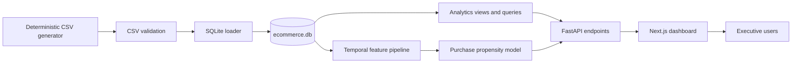
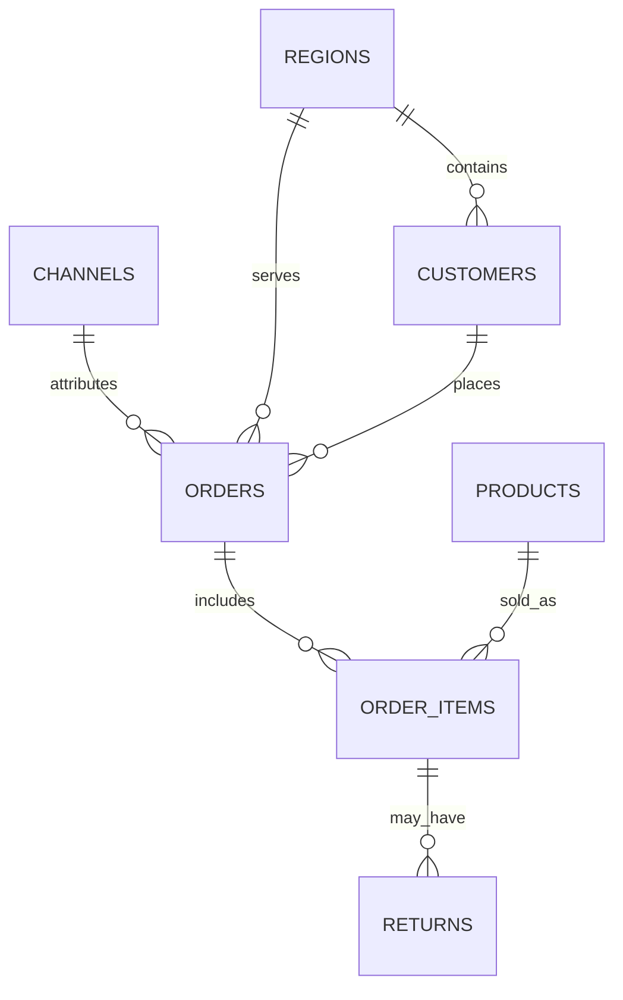

# Meridian E-commerce Analytics

Meridian is a complete, locally runnable e-commerce business intelligence portfolio project. It combines deterministic synthetic sales data, SQLite analytics, a 30-day purchase propensity model, FastAPI endpoints, and a responsive Next.js executive dashboard.

**Live demo:** https://meridian-ecommerce-analytics.onrender.com

## Live Demo

Open the deployed analytics dashboard at [meridian-ecommerce-analytics.onrender.com](https://meridian-ecommerce-analytics.onrender.com).

## Business objective

The dashboard helps commerce leaders understand revenue and profitability, compare categories and regions, evaluate channel contribution, identify repeat customers, monitor return risk, and prioritize customers for retention outreach.

The synthetic dataset spans January 2024 through December 2025. It is intentionally fictional and contains no personal or proprietary source data.

## Architecture



## Entity relationship diagram



## Data product

Generated CSV files:

- `data/customers.csv`
- `data/products.csv`
- `data/channels.csv`
- `data/regions.csv`
- `data/orders.csv`
- `data/order_items.csv`
- `data/returns.csv`

Refresh the complete data product and SQLite database:

```powershell
.\refresh-data.ps1
```

Equivalent cross-platform commands:

```powershell
python scripts/generate_ecommerce_data.py
python scripts/validate_data.py
python scripts/load_sqlite.py
```

The generator is seeded with `SEED = 2024`, so refreshes reproduce the same data.

## Data dictionary

| Table | Key fields | Description |
|---|---|---|
| `customers` | `customer_id`, `region_id` | Customer profile, loyalty status, signup date, and cohort |
| `products` | `product_id`, `sku`, `category` | Product catalog, list price, cost, and active status |
| `channels` | `channel_id`, `channel_name` | Acquisition and transaction channel |
| `regions` | `region_id`, `region_name`, `country` | Customer and order market |
| `orders` | `order_id`, `customer_id`, `channel_id`, `region_id`, `ordered_at` | Order header, status, gross revenue, and discount |
| `order_items` | `order_item_id`, `order_id`, `product_id`, `quantity` | Item-level revenue and cost |
| `returns` | `return_id`, `order_item_id`, `refund_amount` | Returned quantity, refund, reason, and date |

## SQL methodology

`sql/schema.sql` defines the normalized SQLite/PostgreSQL-compatible schema, foreign keys, checks, and indexes. `sql/views.sql` provides monthly performance, category, channel, and RFM views. `sql/analysis.sql` contains named revenue, profit, AOV, repeat purchase, regional/category, channel, and return analyses.

Metric definitions:

- Revenue: completed order item net revenue after discounts.
- Profit: net revenue minus item cost.
- AOV: net revenue divided by completed distinct orders.
- Repeat purchase rate: customers with more than one completed order divided by customers with at least one.
- Return rate: distinct returned order items divided by distinct sold order items.
- RFM: 5-bucket recency, frequency, and monetary scoring with an RFM segment label.

## Machine learning

The model predicts whether a customer makes at least one completed purchase in the next 30 days.

The temporal method uses 2025-08-01 as a feature cutoff and 30-day purchase labels, then evaluates against a held-out 2025-10-01 cutoff. Features include loyalty status, cohort, region, historical orders, category breadth, monetary value, refund value, and recency.

Train the model:

```powershell
python ml/train.py
```

The saved artifacts are:

- `backend/models/purchase_propensity.joblib`
- `backend/models/purchase_propensity_metrics.json`
- `backend/models/feature_importance.json`

Run CLI inference:

```powershell
python ml/predict.py --loyalty-member 1 --segment-cohort Loyal --region-name "North America" --order-count 6 --category-count 3 --monetary 1840 --refund-amount 24 --recency-days 18
```

The pipeline is logistic regression with median imputation, standard scaling, one-hot categorical encoding, and balanced class weights. The metrics JSON records test accuracy, precision, recall, F1, and ROC-AUC. Coefficient magnitudes provide practical feature importance.

## Dashboard

The dashboard includes executive KPIs, monthly revenue trends, category margin and revenue performance, channel attribution, regional performance, RFM customer ranking, filters, and an interactive 30-day propensity score.

## Run locally

Prerequisites:

- Python 3.11 or newer
- Node.js 20 or newer

Backend:

```powershell
python scripts/load_sqlite.py
python ml/train.py
cd backend
python -m pip install -r requirements.txt
python -m uvicorn app.main:app --reload --host 127.0.0.1 --port 8000
```

Frontend:

```powershell
$env:NEXT_PUBLIC_API_URL = "http://localhost:8000"
npm install
npm run dev
```

Open `http://localhost:3000`.

API documentation is at `http://localhost:8000/docs`. Health is at `http://localhost:8000/api/health`.

Repeat startup scripts are also provided:

```powershell
.\start-backend.ps1
.\start-frontend.ps1
```

## Docker

Build and run the combined frontend and API image:

```powershell
docker build -t meridian-analytics .
docker run --rm -p 8000:8000 meridian-analytics
```

Open `http://localhost:8000`.

## Deploy

The repository includes `render.yaml` for a free-tier Docker web service on Render. Create a new Render Blueprint from this repository, select the Blueprint, and deploy. Render sets the public HTTPS endpoint automatically. No paid database or API secret is required.

The container exposes port `8000` and defines `/api/health` as the health check.

Other Docker hosts can use the same `Dockerfile`.

## Tests

Run focused backend tests:

```powershell
python scripts/load_sqlite.py
python ml/train.py
python -m pytest -q backend/tests
```

Build the frontend:

```powershell
npm ci
npm run build
```

GitHub Actions runs data generation, validation, SQLite loading, ML training, pytest, and the Next.js production build.

## Production considerations

This portfolio app does not include authentication or secrets. For production use, add identity and role-based access, an external managed database, encrypted transport, database backups, centralized logs, cache controls, and rate limiting. Prediction results should support—not replace—customer decision governance.
